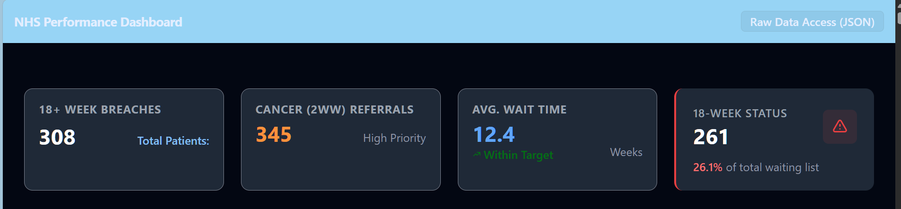
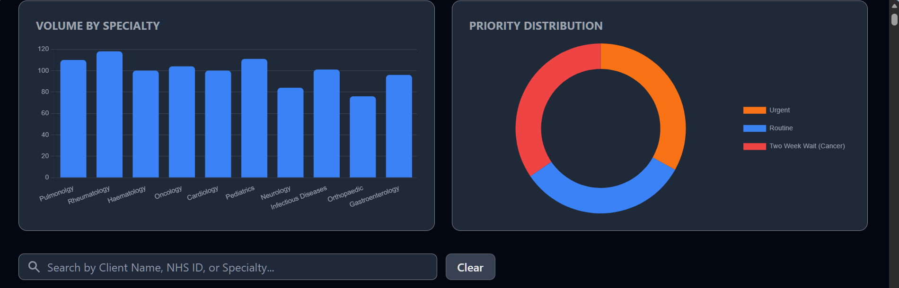
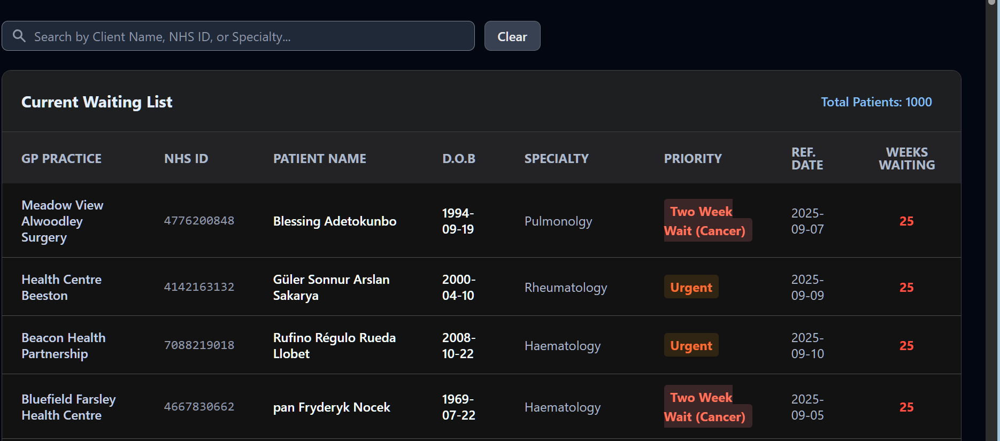
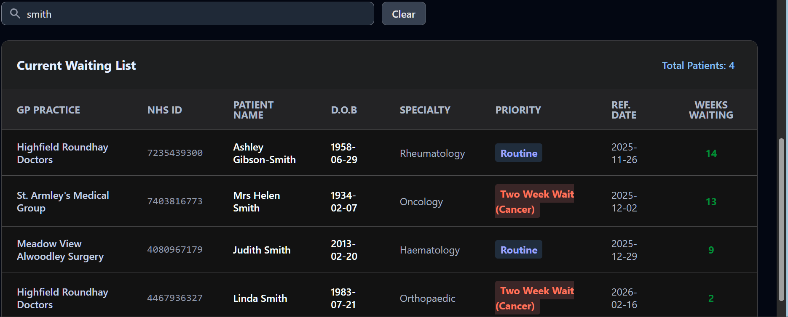
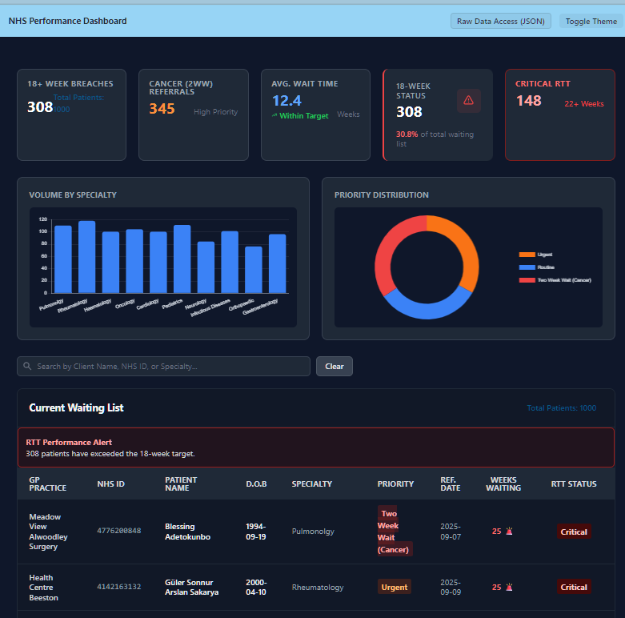
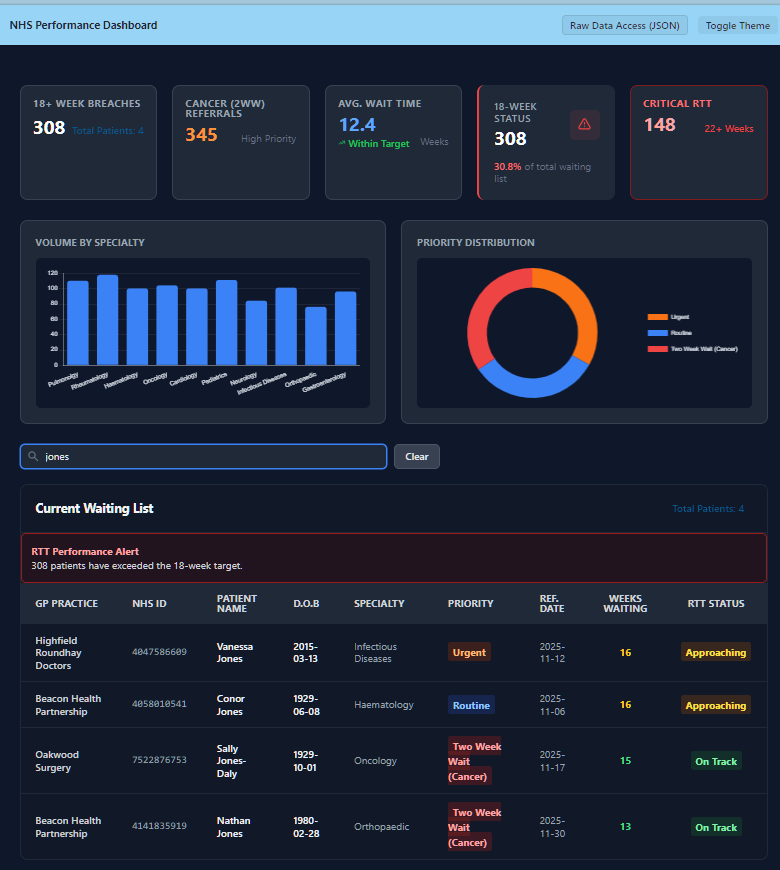

# 🏥 NHS Performance Dashboard


An end-to-end Clinical Intelligence suite that monitors patient wait times and identifies RTT (Referral to Treatment) breaches using a high-performance DuckDB analytical engine. This project features a full modular pipeline: synthetic patient generation with Faker and nhs-number validation, high-speed data processing via Polars and Pandas, and a FastAPI-powered dashboard with real-time waitlist metrics and specialty distribution charts

---

## 🗒️ Table of Contents

- [Problem](#️-problem)
- [Solution](#-solution)
- [Why I Built This](#-why-i-built-this)
- [Screenshots](#-screenshots)
- [Setup Instructions](#️-setup-instructions)
- [Project Structure](#-project-structure)
- [Tech Stack](#-tech-stack)
- [Testing](#-testing)
- [Notes](#-notes)
- [Roadmap Features](#️-roadmap-features)

---

## 🕵🏼‍♂️ Problem 

NHS waiting lists remain one of the biggest operational challenges facing healthcare providers.
Managing thousands of referrals across multiple specialties can make it difficult to identify patients approaching RTT targets, monitor breach rates, and understand service demand.
Operational teams need fast access to waiting-list data and meaningful visualisations that support informed decision-making.

## ✅ Solution

This project simulates an NHS waiting-list dashboard using FastAPI, DuckDB, and synthetic patient data.

The dashboard provides:

- 18-week RTT breach monitoring
- Cancer referral tracking
- Waiting-time metrics
- Searchable waiting-list records
- Interactive charts by specialty and priority

The solution demonstrates how modern Python data tooling can be combined to build lightweight operational dashboards.

---

## 🧠 Why I Built This

I built this project to explore how Python can be used to solve operational data problems commonly found in healthcare settings.
The goal was to combine data generation, validation, storage, analytics, testing, and visualisation into a single end-to-end application.
It also provided an opportunity to work with DuckDB, FastAPI, Pydantic validation, and dashboard development while applying real-world business rules such as NHS RTT breach calculations.

---

## 📸 Screenshots

<details>
  <summary>click here</summary>

### Dashboard Overview
- Dashboard overview showing key waiting-list KPIs, RTT breaches, cancer referrals, and average wait times.


- Interactive charts showing patient volume by specialty and referral priority distribution.


- Searchable patient waiting-list table with referral, priority, and RTT tracking information.


- Live search filters patient records by name, NHS ID, or specialty.


- Enhanced RTT monitoring featuring RTT breach KPIs, critical 22+ week alerts, operational warning banners, and colour-coded patient status indicators.


- RTT status indicators help operational teams quickly identify patients approaching breach thresholds and prioritise intervention before critical delays occur.


</details>

---

## 🛠️ Setup Instructions

### Clone the Repository

```bash
git clone https://github.com/reory/nhs-performance-dashboard.git
cd nhs-performance-dashboard
```

### Create a Virtual Environment

```bash
uv venv
# Windows
source venv/Scripts/activate
# macOS/Linux 
source .venv/bin/activate
```

### Install Dependencies
```bash
uv sync
```

### Install dev dependencies
```bash
uv sync --all-groups
```

### Initialise the Data Engine
```bash
uv run python scripts/generate_faker_data.py
```

### Launch the Dashboard
Run the Uvicorn server to host the FastAPI application.
```bash
uv run uvicorn app.main:app --reload
```
Navigate to http://127.0.0.1:8000 to view the live clinical suite.

---

## 📁 Project Structure

<details>
  <summary>click here</summary>

```plaintext
nhs_performance_dashboard/
├── app/
│   ├── main.py
│   ├── database.py
│   ├── models.py
│   ├── routers/
│   │   ├── api.py
│   │   └── dashboard.py
│   └── templates/
|       ├── html_components/
|       |    └── charts.html
|       |    ├── metrics.html
│       |    ├── navbar.html
│       |    ├── search_bar.html
│       |    ├── table.html
|       ├── js_components/
|       |    └── charts_logic.html
|       |    ├── js_scripts.html
│       |    ├── metrics.html
│       |    ├── search_logic.html
│       ├── base.html
|       ├── index.html
├── data/
│   └── hospital_data.db
├── scripts/
│   └── generate_faker_data.py
|   └── view_all.py
├── tests/
|   └── conftest.py
|   └── test_clinical_logic.py
|   └── test_connection.py
|   └── test_validation.py
├── .venv
├── pyproject.toml
├── README.md
├── CONTRIBUTING.md
└── LICENCE.md
```

</details>

---

## 💻 Tech Stack

* **Framework:** [FastAPI](https://fastapi.tiangolo.com/) (High-performance Python API)
* **Database:** [DuckDB](https://duckdb.org/) (In-process analytical database)
* **Validation:** [Pydantic](https://docs.pydantic.dev/) & [nhs-number](https://pypi.orgproject/nhs-number/)
* **Testing:** [Pytest](https://docs.pytest.org/) (Unit and Logic testing)
* **Frontend:** `Jinja2` Templates, `HTML5`, `CSS3` (NHS Frontend Framework styles)

---

## 🧪 Testing

- Run the test suite

```bash
uv run pytest
```

---

## 📝 Notes

<details>
  <summary>click here</summary>

- Data Privacy: This project uses synthetic data generated by Faker. No real patient data is included or required to run the demo.

- Hybrid Data Strategy: This dashboard utilises DuckDB for high-performance (Analytical) queries while using FastAPI for low-latency web responses. This ensures that complex RTT breach calculations don't block the main application thread

- Modular Component Architecture: To ensure scalability and maintainability, the UI is architected into standalone html_components and js_components. This allows for a "plug-and-play" development cycle where individual dashboard metrics can be updated without refactoring the entire core layout.

- Automated Validation & Testing: The system includes a full Pytest suite and nhs-number checksum validation to ensure clinical data integrity—mirroring the "modular and predictable" package standards implemented in my previous projects.

</details>

---

## 🛣️ Roadmap Features

<details>
  <summary>click here</summary>

- [x] Enhanced RTT Monitoring
Highlight patients approaching or exceeding the 18-week RTT target using additional visual indicators and status badges.

- [x] Specialty Filtering
Filter the waiting list by clinical specialty to analyse service demand and RTT pressures.

- [ ] Sortable Waiting List
Allow users to sort patient records by waiting time, referral date, specialty, or priority.

- [ ] Expanded Performance Metrics
Add specialty-specific averages and priority-based KPI tracking to provide deeper operational insight.

- [ ] Export Filtered Results
Download filtered waiting-list data as CSV for operational reporting and analysis.

- [ ] Email Alerts
Notify administrators when patients are approaching the 18-week RTT threshold.

- [ ] Geospatial Regional Mapping
Integrate a Folium or Leaflet map to visualise patient distribution and referral patterns across West Yorkshire.

- [ ] Predictive Analytics (ML Forecasting)
Develop a machine learning model using Scikit-Learn or XGBoost to identify potential RTT breach hotspots based on historical referral trends and specialty demand.

</details>

---

<details>
  <summary>❤️ Thanks</summary>

**Faker** - For helping create the fake data.
The NHS Digital Community: For maintaining the open standards and logic found in the nhs-number validation libraries.

**FastAPI & NiceGUI** Teams: For creating high-performance frameworks that make complex clinical dashboards possible with Python.

The Open Source Community: For the **Faker** and **DuckDB** projects, which allow developers to build and test robust systems without compromising real-world patient privacy.

</details>

---

**Built By Roy Peters** [Click here for contact details😁](https://www.linkedin.com/in/roy-p-74980b382/)